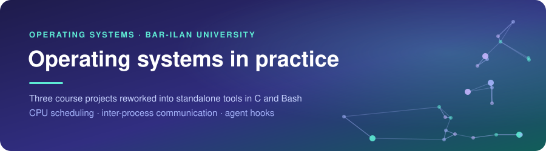
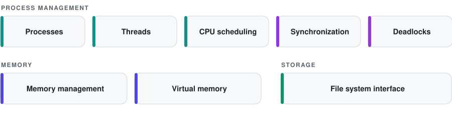

<div align="center">



<br><br>


<br>

<a href="#cpu-scheduler-simulator"></a>&nbsp;
<a href="#ipc-channels"></a>&nbsp;
<a href="#agent-hooks"></a>&nbsp;
<a href="#try-it-yourself"></a>&nbsp;
<a href="#contact"></a>

</div>

<br>

Hi, I'm Or, a computational biology student at Bar-Ilan University. Operating Systems was a core course in my degree, and one I found particularly engaging. Its central topics were:

<picture>
  <source media="(prefers-color-scheme: dark)" srcset="assets/topics-dark.svg">
  
</picture>

I extended three of the course assignments into standalone tools. For each one I hardened the implementation against edge cases and failure modes, built a dedicated test suite, and documented the design decisions behind it.

<br>

## CPU scheduler simulator


A scheduling simulator in which every job is a real process, controlled by the scheduler through POSIX signals. It runs FCFS, SJF, Priority and Round Robin on the same workload and compares their average waiting and turnaround times.

Building it turned scheduling theory into something observable: how each policy balances waiting time, turnaround and fairness, and how the operating system imposes those decisions on processes that are entirely unaware of them.

**[Check out the CPU scheduler →](./cpu-scheduler)**

<br>

## IPC channels


A single data stream transferred between two processes through four channels, a pipe, a named pipe and two shared-memory designs, with every transfer verified against the source.

It offered a side-by-side view of the two fundamental IPC models, message passing through the kernel and shared memory, and of the trade-off between them: the safety and convenience the kernel provides on one side, and on the other the control shared memory gives the processes, along with full responsibility for coordinating between them.

**[Check out the IPC channels →](./ipc-channels)**

<br>

## Agent hooks


Six Bash hooks that enforce safety policies around an AI coding agent: they block destructive commands, back up files before they are modified and validate the result. A standalone runner simulates the agent's hook calls, so each hook can be tested in isolation.

It brought together the building blocks every process relies on, standard streams, exit codes, files and concurrent access to them, in a system where a mistake has real consequences. Designing it meant assuming that input may be hostile and that several processes may act on the same files at once, and testing for both.

**[Check out the agent hooks →](./agent-hooks)**

<br>

## Try it yourself

You're welcome to build the projects and watch them work. Each folder has an `examples/` directory with a demo that runs the tool on a fixed input and compares the result with the output saved next to it, so you can compare your run with mine.

```
cpu-scheduler/
  scheduler.c, Makefile
  examples/
    processes.csv          the jobs for the demo
    run_demo.py            runs all four policies with a time quantum of 2
    demo_output.txt        saved output of a full run
ipc-channels/
  channels.c, Makefile
  examples/
    run_demo.py            sends 100000 records through each channel
    demo_output.txt        saved output of a full run
agent-hooks/
  hook_runner.sh, hooks/, config/
  examples/
    demo.sh                sends four commands through the hooks
    demo_output.txt        saved output of a full run
```

The projects run on Linux and macOS. The C projects need a C compiler and make, the demos need Python 3, and the hooks need jq. From the repository root:

```
cd cpu-scheduler
make
python3 examples/run_demo.py
```

```
cd ipc-channels
make
python3 examples/run_demo.py
```

```
cd agent-hooks
bash examples/demo.sh
```

Every folder also has `make test`, with the full set of checks.

<br>

## Contact

If you're hiring for a systems or software role, I'd be glad to hear from you.

<a href="mailto:or.brener.2015@gmail.com"></a>&nbsp;
<a href="https://www.linkedin.com/in/or-brener2026"></a>
