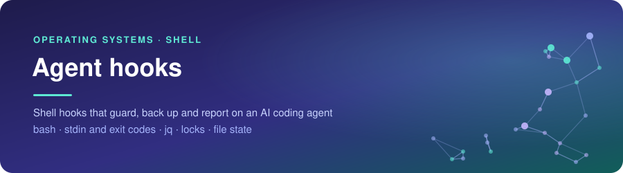
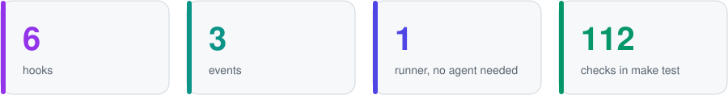
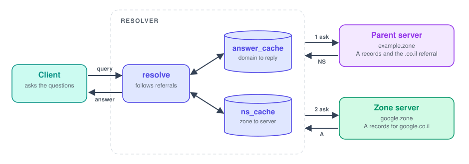

<div align="center">



<br><br>


<br>

<a href="#how-it-behaves"></a>&nbsp;
<a href="#key-parts"></a>&nbsp;
<a href="#decisions"></a>&nbsp;
<a href="#running-it"></a>

</div>

<br>

## Summary

Six shell hooks for an AI coding agent, plus a runner that calls them the way Claude Code would. Before a command runs, they block dangerous commands, cap the number of commands per session and check commit messages. Before an edit they back up the file, after it they check its syntax, and when the session ends they write a summary. Each hook reads a JSON payload on stdin and answers with its exit code.

<picture>
  <source media="(prefers-color-scheme: dark)" srcset="assets/facts-dark.svg">
  
</picture>

<br>

## How a hook call works

<picture>
  <source media="(prefers-color-scheme: dark)" srcset="assets/flow-dark.svg">
  
</picture>

<br>

## How it behaves

- `firewall.sh` blocks a Bash command that matches a pattern in `config/dangerous_patterns.txt`, and gives the comment above the pattern as the reason
- `rate_limiter.sh` counts commands per session, warns past `WARNING_THRESHOLD` and blocks past `MAX_COMMANDS`, with a count per command type
- `commit_validator.sh` checks the message of a `git commit`: a known prefix, 10 to 72 characters and no full stop at the end. When the prefix is missing it suggests one from the staged changes
- `auto_backup.sh` copies a file before it is edited and keeps the newest `MAX_BACKUPS` copies
- `syntax_checker.sh` checks shell, Python and C files after an edit
- `session_summary.sh` turns the session log into a report for Claude Code to show
- `hook_runner.sh` reads `hooks.txt` and runs the hooks for one event and tool in order

<br>

## Key parts

- `lib.sh` holds what every hook shares: reading the JSON with `jq`, a safe session id, reading numbers from `hooks.conf`, and a lock
- `hooks.txt` maps events and tools to scripts for the runner, and `claude-settings.example.json` does the same for Claude Code
- `config/` holds the patterns, the commit prefixes and the limits
- State and logs go to `data/`, or to `HOOKS_DATA_DIR` when it is set

<br>

## Decisions

- Fields are read with `jq` instead of `grep` and `sed`. A command containing `\"` or a payload with a space after a colon used to hide the rest of the command from the firewall
- A guard that cannot read its input blocks. The other hooks skip
- The backup runs before the edit. Run after it, it only saves what the agent just wrote, and the file as it was before the first edit is never kept
- Backup names hold the whole path, so files with the same name in different folders keep separate copies and separate rotation
- The rate limiter updates its state file under a lock made with `mkdir`, which is atomic on every POSIX system, and replaces the file with a rename. 40 calls at once count to exactly 40
- Session ids and command types are reduced to safe characters, since they end up in file names and in a `|`-separated file
- A commit counts only at the start of a command or after `;`, `&&`, `||` or `|`, so `echo git commit` is not checked
- A message built with `$(...)` cannot be checked without running it, so it is blocked with a reason
- Python is checked by parsing it, which does not write a `__pycache__` folder into the project
- Everything runs on bash 3.2, the version macOS ships

<br>

## Limits

- The firewall is a list of patterns, not a sandbox. A command hidden in a variable, in base64 or in a script written first and run later gets through, and a pattern can match text inside an echo
- Recursive deletes are blocked in every form, including harmless ones like `rm -r build`
- A C file that includes headers from elsewhere in the project can be reported as a syntax error
- Needs `jq`
- Tested with the runner on Linux and macOS. Not tested inside Claude Code

<br>

## Running it

```
echo '{"tool_name":"Bash","tool_input":{"command":"rm -fr build"}}' | ./hook_runner.sh PreToolUse Bash
make demo
make test
```

The same checks run automatically on Linux and macOS on every push.
