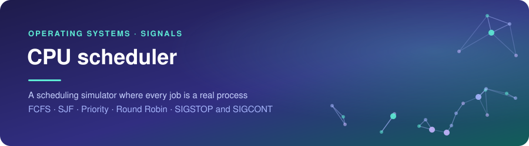
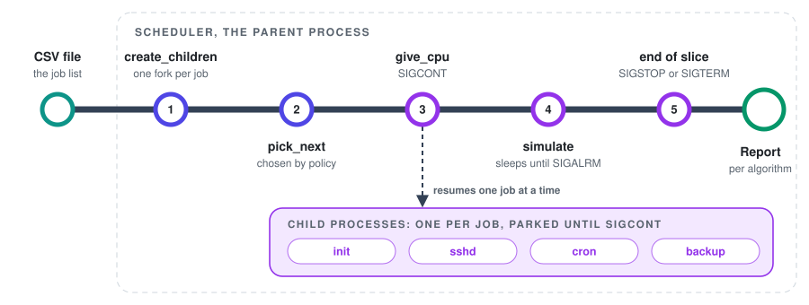

<div align="center">



<br><br>


<br>

<a href="#how-it-behaves"></a>&nbsp;
<a href="#key-parts"></a>&nbsp;
<a href="#decisions"></a>&nbsp;
<a href="#running-it"></a>

</div>

<br>

## Summary

A CPU scheduling simulator in C where every simulated process is a real child process. The scheduler gives a process the CPU with `SIGCONT`, takes it back with `SIGSTOP`, and lets time pass by sleeping on a timer. It runs FCFS, SJF, Priority and Round Robin on the same CSV file and prints a timeline for each.

<picture>
  <source media="(prefers-color-scheme: dark)" srcset="assets/facts-dark.svg">
  
</picture>

<br>

## How a job is scheduled

<picture>
  <source media="(prefers-color-scheme: dark)" srcset="assets/flow-dark.svg">
  
</picture>

<br>

## How it behaves

- Input is one CSV line per job: name, description, arrival, burst and priority. Blank lines and `#` comments are skipped, and a bad line stops the run with the file name and line number
- The four algorithms run one after the other on the same list, in this order: FCFS, SJF, Priority, Round Robin
- FCFS, SJF and Priority are non-preemptive. When two jobs tie, the one that comes first in the file runs first
- Round Robin runs a job for at most one quantum and sends it to the back of the queue. A job that arrives during a slice joins the queue ahead of the one that was preempted
- Gaps with nothing to run are printed as `Idle` and do not count as waiting time
- Each run ends with a report: the average waiting time for the first three, the total turnaround time for Round Robin
- With `--compare`, a table at the end puts the four algorithms side by side on average waiting time and average turnaround time. In Round Robin, a job's waiting time is its turnaround time minus the time it actually ran

```
   Algorithm       Avg waiting   Avg turnaround
   FCFS                   4.67             8.00
   SJF                    3.67             7.00
   Priority               3.83             7.17
   Round Robin            5.67             9.00
```

On this input (`examples/processes.csv`, quantum 2) SJF has the lowest waiting time and Round Robin the highest. That depends on the input, and a different job list can change the order.

<br>

## Key parts

- `create_children` forks one child per job. Each child stops itself with `SIGSTOP`, and the parent waits until it is parked before it schedules anything
- `give_cpu`, `take_cpu` and `terminate` are the three moves on a job: `SIGCONT`, `SIGSTOP`, and `SIGTERM` followed by a reap
- `simulate` arms the timer and sleeps until `SIGALRM` arrives
- `pick_next` holds the selection rule for each policy in one place
- `Queue` is a circular array of job indexes for Round Robin
- `on_interrupt` is the handler that cleans up the children

<br>

## Decisions

- The wait uses `sigsuspend` with `SIGALRM` blocked, not a `pause()` loop. With `pause()`, a signal that lands between checking the flag and going to sleep is lost and the scheduler sleeps forever
- `SIGCONT` is sent before `SIGTERM`, because a stopped process does not act on `SIGTERM` until it is continued
- Ctrl-C and `SIGTERM` kill every child before the scheduler exits. A stopped child would otherwise outlive its parent
- `--unit-ms N` sets one time unit to N milliseconds, so the demo runs in about a second. Without it, a unit is a real second
- Input is validated before anything is forked, so a bad file or a quantum of 0 never leaves processes behind

<br>

## Limits

- The children do no work. Time is simulated by the scheduler, and a child exists only to be stopped and resumed
- `SIGKILL` on the scheduler leaves its children stopped. Only `SIGINT` and `SIGTERM` are handled
- Tested on Linux and macOS

<br>

## Running it

```
make
./scheduler examples/processes.csv 2
./scheduler examples/processes.csv 2 --unit-ms 20 --compare
make test
```

`make test` runs the demo and 20 more checks: bad input, the comparison numbers on a small case worked out by hand, and cleanup after Ctrl-C. The demo output is saved in `examples/demo_output.txt`.
