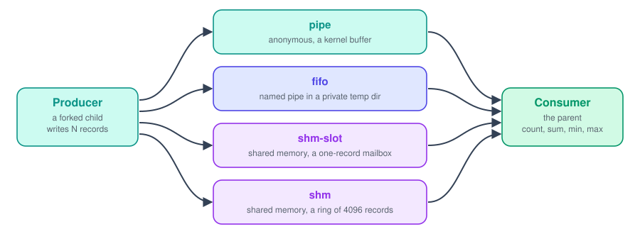

<div align="center">


<br><br>


<br>

<a href="#how-it-behaves"></a>&nbsp;
<a href="#key-parts"></a>&nbsp;
<a href="#decisions"></a>&nbsp;
<a href="#running-it"></a>

</div>

<br>

## Summary

One program that sends the same stream of numeric records from a producer process to a consumer process through four channels: an anonymous pipe, a named pipe (FIFO), and System V shared memory in two designs, a one-record mailbox and a ring buffer. The consumer computes count, sum, min and max, and every run is checked against the generator. A compare mode runs all the channels on the same input and prints how long each took.

<picture>
  <source media="(prefers-color-scheme: dark)" srcset="assets/facts-dark.svg">
  
</picture>

<br>

## How the data moves

<picture>
  <source media="(prefers-color-scheme: dark)" srcset="assets/flow-dark.svg">
  
</picture>

<br>

## How it behaves

- The producer is a forked child and the consumer is the parent. Record `i` has the value `(i * 1103515245 + seed) mod 100000`
- The four channels are `pipe`, `fifo`, `shm-slot` (a mailbox that holds one record at a time) and `shm` (a ring buffer of 4096 records)
- Every run is compared with aggregates computed straight from the generator, and a mismatch is an error
- `--batch K` sends K records per write on a pipe or FIFO, instead of one
- `compare` runs six setups on the same input and prints the time of each

<br>

## Key parts

- `produce_stream` and `consume_stream` move records through a pipe or FIFO in batches
- `run_pipe` and `run_fifo` set up the channel, fork the producer and clean up
- `shm_create` makes a shared segment, attaches it and marks it for removal
- `Slot` is the one-record mailbox, with a flag that says empty or full
- `Ring` holds the 4096 slots and two counters, `head` for the consumer and `tail` for the producer
- `still_producing` and `producer_wait` notice when the other process has died
- `run_channel` runs one channel and checks its result

<br>

## Decisions

- The segment is created with `IPC_PRIVATE` and marked for removal right after it is attached. It lives until the last process detaches, so even `kill -9` leaves nothing behind
- The mailbox and the ring publish with C11 release stores and read with acquire loads. A plain `volatile` flag stops the compiler from caching it, but does not order the write of the value before the write of the flag
- `head` and `tail` sit on separate cache lines, and each side publishes once per chunk instead of once per record
- Shared memory has no EOF, so the consumer knows `N` and stops after `N` records. It also checks every 4096 spins whether the producer has exited, and the producer checks whether its parent is gone
- The FIFO lives in a private directory made with `mkdtemp`, and it is removed on exit, on errors and on Ctrl-C
- The parent closes its copy of the pipe's write end. Otherwise the reader never sees EOF

<br>

## Limits

- `kill -9` on the parent of a FIFO run leaves its temp directory in `/tmp`
- Records are 8-byte integers in the machine's byte order, so the stream is not meant to cross machines
- The ring size is fixed in the source
- Tested on Linux and macOS

<br>

## Running it

```
make
./channels shm 1000000 7
./channels pipe 1000000 7 --batch 512
./channels compare 1000000 7
make test
```
